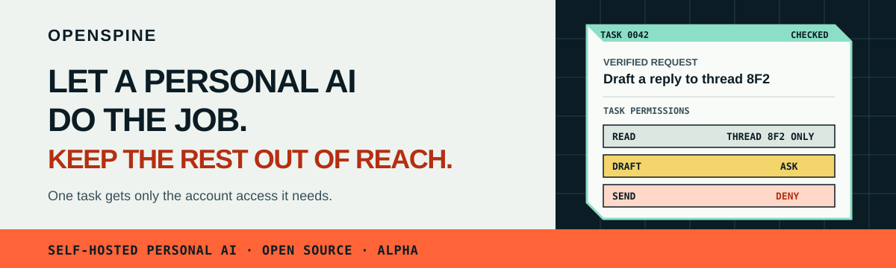
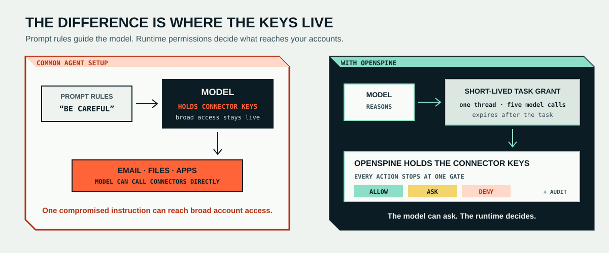
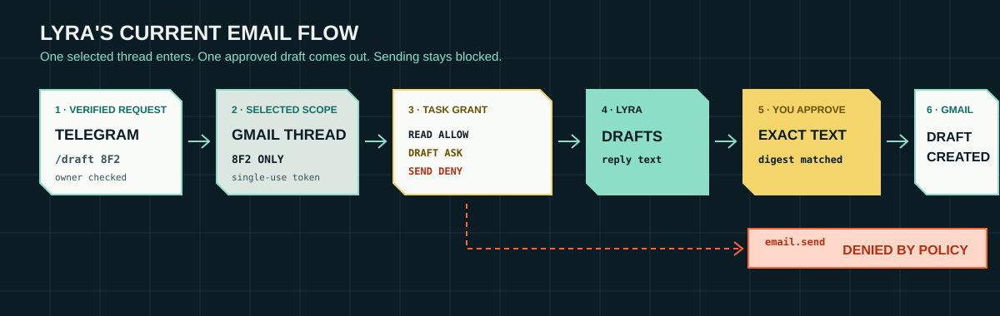

<picture>
  
</picture>

<p align="center">
  <a href="https://george-rd.github.io/openspine/"><strong>Website</strong></a>
  ·
  <a href="https://george-rd.github.io/openspine/comparison/"><strong>How it differs</strong></a>
  ·
  <a href="https://george-rd.github.io/openspine/quickstart/"><strong>Quickstart</strong></a>
  ·
  <a href="https://george-rd.github.io/openspine/threat-model/"><strong>Threat model</strong></a>
  ·
  <a href="https://george-rd.github.io/openspine/roadmap/"><strong>Roadmap</strong></a>
  ·
  <a href="https://ko-fi.com/george_builds"><strong>Support</strong></a>
</p>

# OpenSpine

**Let your AI earn more responsibility. One job at a time.**

OpenSpine is a self-hosted personal AI system that comes with **Lyra, the assistant you talk to**. Give Lyra one clear job, review the result, then let repeated work become a responsibility you can inspect, limit, pause, or remove.

**Lyra can learn the job. It cannot promote itself.**

OpenClaw and Hermes show how capable personal agents can become. OpenSpine is built around how that capability grows: through reviewed delegation, versioned changes, and short-lived task limits rather than one model-controlled process accumulating broad access.

> **Alpha today:** Lyra can chat locally and complete one guarded Gmail draft flow. These are the first working rungs, not the product ceiling. The runtime underneath already includes contained workers, declarative workflows, standing rules, and governed learning. The seamless owner experience that joins them is still being built.

## Why useful autonomy needs a growth model

Most personal agents face a bad choice:

- ask the owner about every meaningful action forever; or
- start with broad access to inboxes, files, accounts, tools, and infrastructure.

The first is safe but exhausting. The second is capable but hard to reason about.

OpenSpine is built for a third path: **each task starts bounded, while repeated safe work can become a reviewed, revocable responsibility.**

The failure scenes are ordinary:

- a poisoned email tells the model to read more mail;
- the agent selects the wrong customer, thread, or account;
- a skill adds an extra recipient;
- a credential appears in tool output or chat history;
- an approval applies to something different from what you reviewed;
- a new routine quietly becomes broader than the work you delegated.

Prompts, allowlists, approvals, and sandboxes all help. OpenSpine adds a harder rule: **learning the job does not become permission by itself.**

## How Lyra grows through delegation

1. **Delegate one clear job.** Lyra receives only the context, tools, and actions needed for that task.
2. **Review the result and the real boundary.** Internal work can proceed quietly; an external action or disclosure can still require approval.
3. **Turn repetition into a proposal.** Repeated approvals, corrections, and preferences can produce a reviewable proposal for a routine, rule, workflow, or preference.
4. **Approve the responsibility.** You choose where it applies, what it may do, its budget, and when it expires.
5. **Keep it revocable.** Matching work can need less interruption, while a changed target, exhausted budget, drift, pause, expiry, or revocation returns control to you.

The complete owner-facing version of this loop is not shipped yet. [Issue #123](https://github.com/George-RD/openspine/issues/123) owns the product work that joins the landed runtime pieces into a natural employee-like experience.

## What happens underneath

```text
you ↔ Lyra
       │ delegates work
       ▼
OpenSpine runtime
  verifies → limits → grants → checks → records
       │
       ▼
contained workers, models, email, and other connectors
```

- **Lyra** talks with you, coordinates work, and can propose reusable changes.
- **The runtime** verifies requests, decides what each task may use, holds credentials, checks actions, and records the result.
- **Workers** receive a short-lived task token and only the context needed for that job. They do not receive raw connector keys.
- **Governed changes** stay inactive until the required review, approval, and activation checks complete.
- **Standing rules** are versioned, budgeted, expiring, and revocable. They do not replace or widen the live task grant.
- **Preferences and persona learning** remain separate from authority, so remembering how you work cannot silently grant more access.

The deterministic task path is:

```text
event → verify → identify → route → compose → grant → run → gate → audit
```

A malicious email can change what the model tries to do. It cannot create permission to read another thread, send an email, or activate a new capability.

<picture>
  
</picture>

## The trade-off against OpenClaw and Hermes

OpenClaw and Hermes offer far more channels, tools, skills, automation, and onboarding than OpenSpine does today. They also provide real security controls.

OpenSpine makes a different trade:

> **Capability should grow through delegation, not arrive as open-ended access.**

The distinction is structural, not a claim that other projects ignore security. OpenSpine keeps task permission and capability activation outside the model. AI-requested effects pass through a gate before dispatch, and reusable authority remains a separate reviewed lifecycle.

See the [full comparison](https://george-rd.github.io/openspine/comparison/) for the current strengths and trade-offs of each approach.

## What works through Lyra today

### Local terminal conversation

`openspine chat` provides a line-oriented local conversation path. Each turn becomes a verified owner request, receives a signed task grant, and runs through the contained model path, action gate, artifact store, and audit trail. The supplied Onyx configuration supports Liquid AI LFM2.5 models without putting the provider token in the worker environment.

### Selected Gmail draft

Through a verified Telegram channel, you can give Lyra one Gmail thread ID. OpenSpine binds the task to that thread, Lyra drafts a reply, and you review the exact text and target before Gmail receives a draft. `email.send` remains denied.

<picture>
  
</picture>

These are first-rung owner paths. They prove the boundary, but they do not yet expose the full employee-like progression described above. The [roadmap](https://george-rd.github.io/openspine/roadmap/) separates owner-facing product capability from runtime machinery that has already landed.

## Runtime support already landed

The runtime includes substantially more than the two current owner paths:

- contained workers, worker supervision, bounded context, and structured results;
- durable workflows, timers, task-board objects, and replay;
- declarative agents, routes, workflows, capability packs, policies, and memory scopes;
- versioned skills and governed promotion;
- standing rules with budgets, expiry, revocation, and drift review;
- a reflection miner that can propose changes but cannot activate them;
- typed preferences, persona overlays, disclosure policy, and encrypted artifacts;
- connector limits, failure handling, audit, export, and restore.

A landed runtime primitive is not automatically a finished Lyra feature. [Issue #119](https://github.com/George-RD/openspine/issues/119) tracks the capability map and owner-path proof required before documentation calls something available through Lyra.

## Proof you can run

Each public boundary claim points to a named test. `scripts/check-claims.sh` fails the build if a listed test disappears.

| Runtime claim | Named test |
|---|---|
| A proposed capability cannot widen authority before approval | `widening_via_a_proposed_pack_requires_approval_first` |
| A spoofed owner ID without a verified source is denied | `spoofed_owner_id_without_verified_source_is_denied` |
| A task cannot read a different Gmail thread | `email_read_selected_thread_rejects_foreign_grant` |
| The agent process receives no raw connector credentials | `process_driver_clears_env_and_sets_only_two_vars` |
| An explicit deny overrides an allow | `explicit_deny_overrides_allow` |
| An approval-required worker action stops before dispatch | `approval_required_action_stops_before_dispatch` |
| Email sending is denied in every grant and approval state | `global_policy_round_trips_and_denies_send` |

The [full claims register](docs/threat-claims.md) covers external content, model calls, approval binding, governed changes, audit artifacts, host operations, and more.

## Current trade-offs

Choose the alpha because the delegation and authority model matters enough to accept:

- Docker, model-provider, and optional Telegram and Gmail OAuth setup;
- a copied Gmail thread ID instead of a polished picker;
- narrow owner-facing workflow breadth;
- no complete progressive-delegation owner experience yet;
- fewer channels and tools than mature agent platforms;
- an architecture and threat model that are still evolving in public.

Do not choose it today if your main requirement is the widest assistant feature set or a consumer-grade setup flow.

## Build and run the checks

```sh
git clone https://github.com/George-RD/openspine.git
cd openspine
npm ci
cargo build --workspace
./scripts/check.sh
```

This runs formatting, lints, tests, strict OpenSpec validation, and the claims register used by CI.

## Run local chat

Build the binaries and put them on the current shell's path:

```sh
cargo build --workspace --bins
export PATH="$PWD/target/debug:$PATH"
```

Run the first-run trust loop. One command writes a configuration and an
owner-only key file, binds you as the single trusted owner, and prints the
trust ceremony (seed key, approval boundary, and how to test it):

```sh
openspine --config openspine.local.yaml init --owner <telegram_user_id> --name "Your Name" --model <model_id>
openspine --config openspine.local.yaml chat
```

`--owner` is your Telegram user id — the trusted principal every later approval
is bound to. `--model` is the model your OpenAI-compatible endpoint serves
(default `http://127.0.0.1:11434`, override with `--base-url`); leave it out and
`init` asks the endpoint, using the model it lists if there is exactly one and
otherwise stopping to ask you to choose. `init` writes absolute `data_dir` and
`lyra_dir` paths, so the configuration works from any directory, and
`openspine.local.yaml` and the `.openspine-control-*` directories it creates are
gitignored. The [first-run guide](docs/first-run.md) explains the ceremony and
the capability rungs beyond it. `openspine setup` remains the interactive
alternative: it asks for your Telegram user id, offers the models your endpoint
actually serves (and can change the model of an existing configuration), and
can log in to a model provider.

Inside the conversation, `/status` prints the readiness report and `/help` lists
the commands. On first start, a configured install prints a short orientation
once; an install that cannot answer yet prints what is blocking it every time.

To check an install without prompts, in a script or over SSH:

```sh
openspine --config openspine.local.yaml setup --check
```

It exits non-zero and names the remedy for every gap that blocks a reply.

For a one-shot smoke test, where stdout is exactly the reply:

```sh
openspine --config openspine.local.yaml chat \
  --once "Reply with exactly OPENSPINE_OK and nothing else."
```

To log in to a hosted model provider, including from a headless or SSH session,
where the authorization URL is printed and the code (or the full redirected
URL) is pasted back:

```sh
openspine --config openspine.local.yaml provider login anthropic
openspine --config openspine.local.yaml provider login openai-codex
```

These use a Claude or ChatGPT subscription rather than API credits. Neither
vendor offers self-service registration for subscription OAuth, so OpenSpine
presents the first-party client id each vendor's own CLI uses, and the request
carries that client's identifying surface (headers, and for Anthropic a
leading system block). Each surface is bound into the provider configuration
digest, so a model-swap approval covers it.

When both credentials are stored, re-running `provider login <id>` switches
the routed provider without a new browser round trip (`--force` re-runs the
authorization). An optional `model_tiers` section in `openspine.yaml` pins
reasoning tiers to providers — for example `high: anthropic` with
`standard: openai-codex` — so different tasks run on different models while
unset tiers keep the active provider.

Antigravity is not offered: its grant needs a provider transport the gateway
does not implement, and login refuses rather than storing a credential no
request could spend.

See [`docs/terminal-chat.md`](docs/terminal-chat.md) and the [quickstart](https://george-rd.github.io/openspine/quickstart/) for the current supported configuration.

## Run the Gmail drafting proof

Compose reads one env file, `.env` beside `compose.yaml`; it does **not** read the `openspine.env` that `openspine init`/`setup` write for the bare-metal path. The server needs these values in `.env`:

- `DOCKER_GID`, the group id of the Docker socket as the Linux daemon sees it (below)
- `OPENSPINE_TELEGRAM_BOT_TOKEN`, from [@BotFather](https://t.me/BotFather)
- `OPENSPINE_ARTIFACT_KEY`, `OPENSPINE_GRANT_HMAC_KEY` and `OPENSPINE_WEBHOOK_HMAC_KEY`, each a separate `openssl rand -hex 32`; all three are required: without the artifact or webhook key the kernel refuses to start, and without the grant key it starts but denies every task (and tells you why)
- credentials for Anthropic, OpenAI, Onyx, or another compatible model provider

For Gmail drafting, follow the [Gmail setup guide](docs/gmail-setup.md). It adds the Google OAuth client, `OPENSPINE_GMAIL_CLIENT_SECRET`, `OPENSPINE_GMAIL_REFRESH_TOKEN`, and a `gmail:` block with your `mailbox_address`.

```sh
cp .env.example .env
openssl rand -hex 32   # run once per key: artifact, grant HMAC, webhook HMAC
docker run --rm -v /var/run/docker.sock:/var/run/docker.sock busybox:1.36 \
  stat -c '%g' /var/run/docker.sock   # the value for DOCKER_GID
```

Paste each generated value into `.env`. Ask a container for `DOCKER_GID` instead of running `stat` on the host: Docker Desktop and OrbStack run the daemon in a Linux VM, so the host's `/var/run/docker.sock` is a symlink whose group (`1` or `20` on macOS) is not the group the kernel container needs. A container reports the socket's group inside the VM (`0` on OrbStack), which is the value `group_add` must receive; on Linux the same command returns the `docker` group id. If you already ran `openspine init` against this data directory, copy its three `OPENSPINE_*_KEY` lines from `openspine.env` into `.env` instead of generating new ones; a different artifact key cannot read existing encrypted state.

Granting the kernel the socket's group gives it host-root-equivalent control of Docker. Treat the kernel container as privileged; the socket-proxy hardening note in `compose.yaml` and [day-2 operations](docs/day-2-operations.md) describe the remaining exposure.

Then copy `openspine.docker.example.yaml` to `openspine.yaml` and set `owner.telegram_user_id` plus the Gmail fields. The kernel logs at `info` by default; set `RUST_LOG` in `.env` for more or less detail.

Build the contained task worker, then start the kernel:

```sh
docker build --file Dockerfile.shell --tag openspine-shell:latest .
docker compose up --build
```

Compose mounts the Lyra package read-only and retains runtime state in `./data`. The kernel's lifetime lock and terminal-erasure ledger live in `./control` (`OPENSPINE_CONTROL_DIR`, set by `compose.yaml`), so recreating the container keeps them with `./data`; back up and restore the two directories together. A deployment that ran before this directory existed has its ledger only inside the old container: migrate it before the first `docker compose up` with the new `compose.yaml`, or the kernel refuses to start with `terminal-erasure continuity is missing`. Stop the old kernel first so the ledger cannot change mid-copy: `docker compose stop kernel`, `mkdir -p control`, find the name with `docker cp "$(docker compose ps -aq kernel)":/app - | tar -t | grep -m1 openspine-control` (lists names only; nothing from `./data` is written to disk), copy it with `docker cp "$(docker compose ps -aq kernel)":/app/.openspine-control-<hash> ./control/` (`docker cp` works on a stopped container), then `docker compose rm -f kernel` so the old copy can never be restarted, and finally `docker compose up -d`. A one-shot initializer fixes that directory's ownership before the non-root kernel starts. The bare-metal process driver is a development shortcut; `/draft` is refused unless `unsafe_allow_uncontained_private_data: true` is set in an isolated development config.

Then message your bot:

```text
/draft <gmail_thread_id>
```

## Documentation

| Document | What it covers |
|---|---|
| [Why OpenSpine](https://george-rd.github.io/openspine/why-openspine/) | Why useful autonomy needs bounded tasks and governed growth. |
| [How OpenSpine differs](https://george-rd.github.io/openspine/comparison/) | A fair comparison with capability-first personal agents. |
| [Architecture](https://george-rd.github.io/openspine/architecture/) | The event path, task grants, gate, artifacts, and audit model. |
| [Roadmap](https://george-rd.github.io/openspine/roadmap/) | What is wired into Lyra, what has landed in the runtime, and what comes next. |
| [`docs/lyra.md`](docs/lyra.md) | The assistant package, declarative model, and capability-growth direction. |
| [`docs/threat-claims.md`](docs/threat-claims.md) | Every security claim and the test or manual proof behind it. |
| [`.raw/openspine-progressive-delegation-positioning-2026-07-31.md`](.raw/openspine-progressive-delegation-positioning-2026-07-31.md) | The positioning correction from narrow proof to employee-like progressive delegation. |
| [`.raw/openspine-layperson-offer-rerun-2026-07-30.md`](.raw/openspine-layperson-offer-rerun-2026-07-30.md) | The earlier Growth Arsenal rerun that established the buyer problem and alpha constraints. |
| [`.raw/openspine-positioning-audit-2026-07-30.md`](.raw/openspine-positioning-audit-2026-07-30.md) | The architecture and positioning audit. |
| [`DIRECTION.md`](DIRECTION.md) | Current process rulings and settled product direction. |
| [`docs/agents/delivery.md`](docs/agents/delivery.md) | Pull requests, bounded stacks, gates, review evidence, and merge. |
| [`openspec/openspine-change-sequence.md`](openspec/openspine-change-sequence.md) | Historical delivery decomposition; not the current backlog or implementation order. |

## Status

Alpha. The OpenSpine system and Lyra run end to end for local owner chat, verified Telegram control, scoped Gmail reads, reply previews, digest-bound draft approval, gated actions, and governed changes. The runtime also contains the substrate for progressive delegation. The owner-facing loop that turns repeated work into clear, revocable responsibility is tracked in [issue #123](https://github.com/George-RD/openspine/issues/123).

## License

Free to use. MIT or Apache 2.0, whichever suits you.
